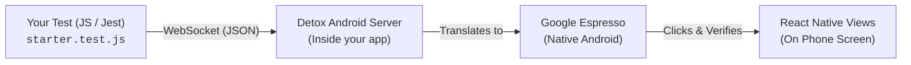

- On Android, Detox is built directly on top of `Espresso`.

* **Detox** = The cross-platform JavaScript API + synchronization layer.
* **Espresso** = The native Android engine that actually executes the taps and checks on your phone.

# How Detox and Espresso Work Together

When you write Detox tests in JavaScript, Detox does not interact with your app from the outside like Appium or Selenium do. Instead, it runs native test code **inside** the Android app process using Espresso.



---

### 1. What does Detox do?
* You write your tests in JavaScript/TypeScript using Jest (`element(by.id('...')).tap()`).
* Detox manages the device, runs the Metro packager, starts the APK, and sends commands over a WebSocket connection to the phone.

---

### 2. What does Espresso do on Android?
* **Native View Interaction:** Espresso is Google’s official native Android UI testing framework. It locates the actual Android `View` components on your screen and performs real hardware-level touch events.
* **Smart Synchronization (Zero `sleep`):** Espresso automatically monitors the Android UI thread. It waits until animations, layout passes, and background tasks are idle before clicking a button or asserting text. This is why tests run reliably without random `sleep(5000)` pauses.

---

### 3. Where is Espresso in Your Project?

You can see Espresso configured in your project’s [`android/app/build.gradle`](file:///D:/FlashlightApp/android/app/build.gradle#L182-L186):

```groovy
androidTestImplementation('com.wix:detox:+')
androidTestImplementation('androidx.test.espresso:espresso-core:3.5.1')
```


## Flow Execution Simple 🧧
- You write test code using JavaScript
- Jest executes your JavaScript test.
- `Detox`: Understands your test instructions and coordinates the testing process with expresso.
- `Espresso`: Performs native Android UI interactions and Espresso finds UI elements, performs interactions and verifies results.
- Android(app): Displays your ui interaction(btnClick) and responds to those interactions (output).
 
- The result is `communicated back` to Detox and Jest for pass/fail.
